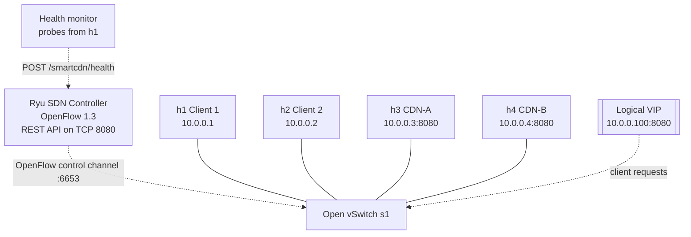

# System architecture

## Topology

The VIP is a logical address handled by the controller. It is not a separate Mininet host. All four hosts share one OVS switch, `s1`; the backend links correspond to switch ports 3 and 4.

## Components

- **`topology.py`** builds the single-switch Mininet topology and fixes host/link order to match the controller's port map.
- **`controller.py`** implements the Ryu application, proxy ARP for the VIP, selection policy, OpenFlow rules, controller status, health updates, and REST endpoints.
- **`server.py`** is a threaded TCP socket server implementing a small HTTP/1.1 GET service and exposing `X-CDN-Server` to identify the selected backend.
- **`client.py`** sends raw-socket HTTP GET requests, reads Content-Length, checks complete bodies, and reports response/throughput metrics.
- **`monitor.py`** probes each backend's `/health` endpoint from a Mininet client namespace and reports state changes and live connect-latency values to Ryu.
- **`benchmark.py`** issues repeated or time-window requests, records per-request results to CSV, and estimates an outage interval when failures are observed.

## Request path

1. A client resolves the VIP through the controller's proxy-ARP response.
2. A new TCP SYN to `10.0.0.100:8080` reaches the controller through the table-miss rule.
3. The controller chooses an eligible backend according to the active policy.
4. The controller installs a forward flow that rewrites destination IPv4/MAC to the chosen backend and outputs to its switch port.
5. A reverse flow rewrites the backend source IPv4/MAC to the VIP identity before returning traffic to the client.
6. Subsequent packets for the same connection use installed switch flows until idle timeout or removal.

## Health and failure behavior

The monitor requires two consecutive failed probes to report an unhealthy backend and two consecutive successful probes to recover it. The controller marks health reports stale after six seconds and removes flows associated with a backend when it becomes unhealthy. New connections then select from the remaining enabled and healthy backends. This does not migrate an established TCP connection.
